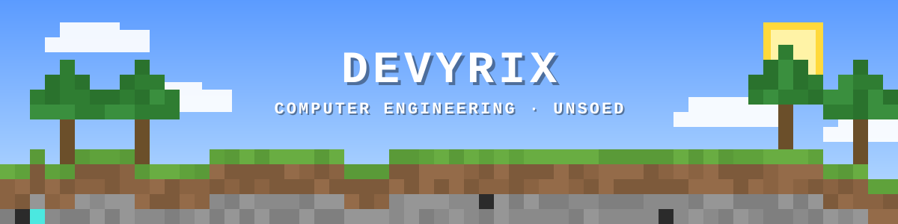

  

 

## ⛏️ About Me

Computer Engineering student at **Universitas Jenderal Soedirman**, batch 2024.
I like building things where hardware meets software, and I'm slowly crafting my way through embedded systems, IoT, and software engineering.

- 🎓 **Student ID:** H1H024049
- 🌱 **Learning:** C/C++, Python, microcontrollers
- 🎯 **Goal:** Build projects that actually work in the real world

 

## 🧰 Tools

  

 

## 📊 Stats

  
  

 

## 📬 Contact

